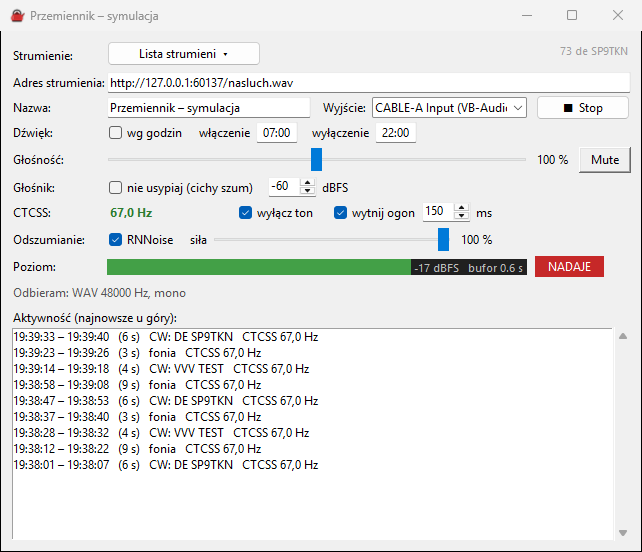
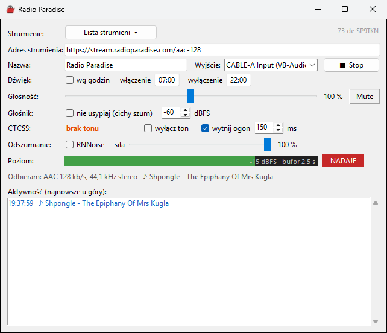
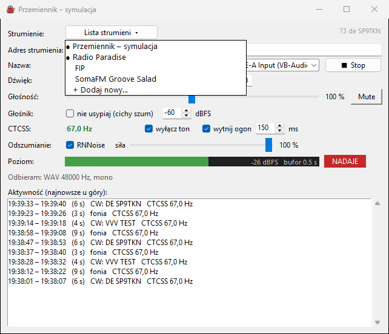
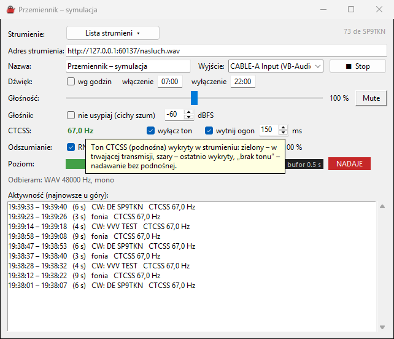
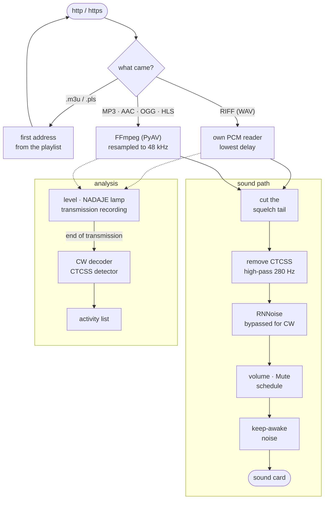

<p align="center"></p>

# Odsłuch stream

> 🇵🇱 Polish version: [README.pl.md](README.pl.md)

> [!IMPORTANT]
> **🇵🇱 The program is in Polish** (the window, the tooltips and the code comments). The [window guide](#the-window)
> below translates every field.

**A small Windows program for listening to audio streams over the internet: remote receivers of repeaters (WAV) and
internet radio (MP3, AAC, OGG, HLS). Every stream has its own window, and the windows can play at the same time. While
you listen, it lists each transmission with its time and length, reads CW identifiers, shows the CTCSS tone (and can
remove it), cuts the squelch tail and reduces noise with RNNoise.** *Odsłuch* is Polish for listening in, monitoring.

<p align="center">
  
</p>
<p align="center"><sub>A simulated repeater stream from a local test server. The program read the CW identifiers
<i>DE SP9TKN</i> and <i>VVV TEST</i> from the audio, marked the voice transmissions (<i>fonia</i>) and found the
67.0 Hz CTCSS tone.</sub></p>

## Features

- **Streams over http and https:** WAV through its own PCM reader (lowest delay); MP3, AAC, OGG (Opus, Vorbis,
  FLAC) and HLS (`.m3u8`) through FFmpeg; `.m3u` and `.pls` playlists. Internet radio titles (ICY) appear in the
  status line and, in blue with ♪, in the activity list.
- **Several streams at once:** the *Lista strumieni ▾* button opens the list of saved streams. A click opens a stream
  in a new window, a right-click edits or deletes it. Each window keeps its own settings.
- **Activity list:** every transmission with its start, end and length, then *CW: …* when the program read Morse code
  (for example a repeater's identifier) or *fonia* (voice), and the CTCSS tone.
- **CTCSS:** detects the sub-audible tone (50 standard tones). *wyłącz ton* removes it from the sound, and *wytnij
  ogon* mutes the squelch tail at the end of each transmission.
- **RNNoise noise reduction**, running on the PC without the internet, with adjustable strength. It switches itself
  off for CW and tones, so it does not cut them.
- **Schedule:** sound only between set hours, also across midnight. Outside them the sound is muted, but reception
  and the activity list keep running.
- Volume 0–200 % (mouse wheel: slow ±1 %, fast ±10 %), Mute, a level meter in dBFS and a *NADAJE* (transmitting)
  lamp.
- **Keep the speaker awake:** a very quiet noise for speakers that switch off in silence (e.g. JBL).
- **Follows Windows sound changes:** when the default output changes (for example after a Remote Desktop session
  starts) or a device disappears, the sound moves without dropping the stream.
- A tooltip for every control: point at it and click the **right** mouse button.

## More windows

<p align="center">
  
  
</p>
<p align="center">
  
</p>
<p align="center"><sub>Internet radio with the song title · the stream list (● = window open) · the tooltip shown by
a right-click. All screenshots were taken from the running program on a separate, empty settings folder.</sub></p>

## The window

| On screen | Meaning |
|---|---|
| **Strumienie: Lista strumieni ▾** | stream list: a click opens the stream in a new window; right-click: *Otwórz* / *Edytuj…* / *Usuń* (open / edit / delete); *+ Dodaj nowy…* adds a stream |
| **Adres strumienia** | stream address (http or https) |
| **Nazwa** | name, shown as the window title and in the list |
| **Wyjście** | sound card; *Domyślne* follows the Windows default |
| **Słuchaj / Stop** | listen / stop |
| **Dźwięk: wg godzin, włączenie, wyłączenie** | sound by schedule: on and off time |
| **Głośność, Mute** | volume, mute |
| **Głośnik: nie usypiaj (cichy szum)** | speaker: keep awake with a quiet noise (−60 dBFS by default) |
| **CTCSS** | the detected tone: green during a transmission, grey for the last one, *brak tonu* = no tone |
| **wyłącz ton, wytnij ogon [ms]** | remove the tone; cut the squelch tail (the sound is delayed by this time) |
| **Odszumianie: RNNoise, siła** | noise reduction and its strength; better off for music |
| **Poziom, NADAJE, bufor** | level meter, transmitting lamp, buffered sound |
| **Aktywność (najnowsze u góry)** | activity, newest on top |

## How it works



- **Transmissions** start when the level rises above −55 dBFS and end after 2 s of silence. Each one is recorded and,
  when it ends, analysed.
- **CW decoder:** looks for a tone between 400 and 1500 Hz, separates dots from dashes by clustering and checks the
  rhythm and the keying purity, so that music and speech do not turn into false CW. On three music stations it reported
  no CW in 661 analysed windows, while it still read all 8 recorded repeater beacons and 20 of 20 synthetic CW signals
  in heavy noise.
- **CTCSS:** an FFT of 60–260 Hz is matched against the 50 standard tones (±1 Hz). The tone is removed by a high-pass
  FIR filter (Kaiser window) from 280 Hz, so the voice from 300 Hz stays unchanged.
- **RNNoise** (Xiph.Org) is trained on speech and would cut Morse code. When the same tone keeps coming back while
  RNNoise's voice detector says "not speech", the program passes the original sound through.
- The sound arrives about 1 s late (buffer, tail cut and noise reduction).
- Settings: `%APPDATA%\Odsluch_stream\config.json`. Log: `%APPDATA%\Odsluch_stream\dziennik.log` (start and end,
  reconnects, errors; keys in stream addresses are masked).

## Download

**[Releases](../../releases)** hold `Odsluch_stream.exe` (Windows 10/11, 64-bit, about 65 MB, no installation) with
the licenses and short instructions in English and Polish. The exe is not signed, so Windows SmartScreen may show
*Windows protected your PC*: click *More info* and *Run anyway*. Some antivirus programs warn about programs packed with
PyInstaller.

## Building

- **From source:** Python 3.14 (64-bit), `pip install -r requirements.txt`, then `py odsluch.py`.
- **The exe:** `build.cmd` (PyInstaller, one file, no console) → `dist\Odsluch_stream.exe`.
- **Your own default stream:** create `domyslne.py` next to `odsluch.py`:
  ```python
  DOMYSLNY_URL = "https://example.org/stream.wav"
  DOMYSLNA_NAZWA = "My repeater"
  ```
  It fills in the first stream when the settings are empty. The file is ignored by git, and `build.cmd` leaves it out
  of the exe (`--exclude-module domyslne`); remove that option for a personal build.
- **The icon** (a kettle) is drawn by `narzedzia/ikona_czajnik.py` (needs Pillow).

## License

[GPL-3.0](LICENSE) © 2026 SP9TKN.

Included third-party code: [RNNoise](https://gitlab.xiph.org/xiph/rnnoise) (Xiph.Org, Mozilla, Jean-Marc Valin;
BSD-3-Clause) as the DLL from [pyrnnoise](https://pypi.org/project/pyrnnoise/) (Apache-2.0), see `rnnoise/`.
[FFmpeg](https://ffmpeg.org) (LGPL-3.0 or later, built without GPL and non-free parts) through
[PyAV](https://github.com/PyAV-Org/PyAV) (BSD-3-Clause), see `licencje_av/` with the source links. Also numpy
(BSD-3-Clause), sounddevice and PortAudio (MIT), Python and Tcl/Tk.

**Tools:** developed with [Claude Code](https://claude.com/claude-code) (Anthropic) — AI assistant used for
coding, testing and documentation.
