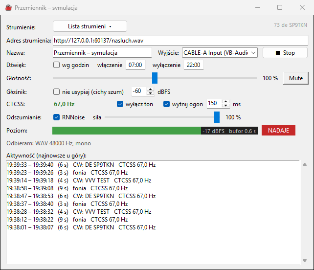
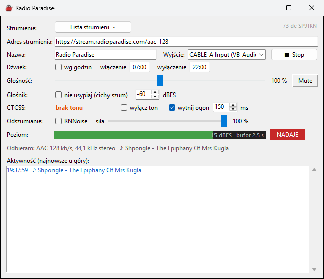
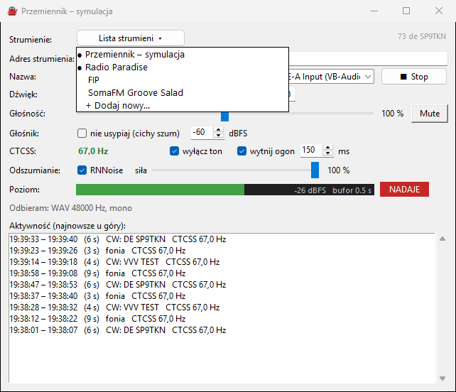
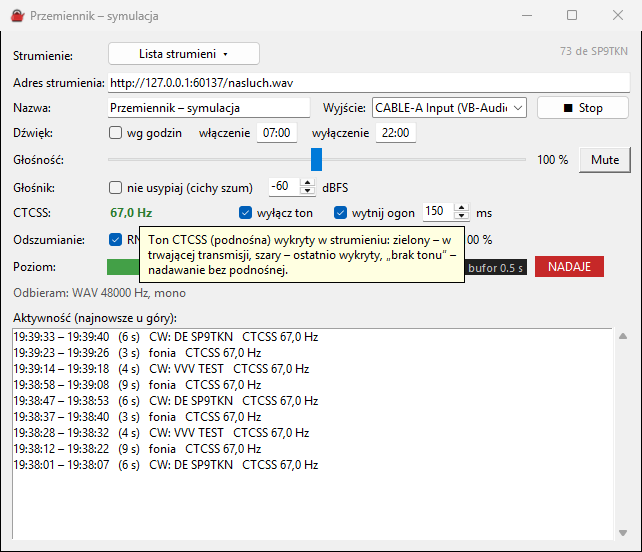
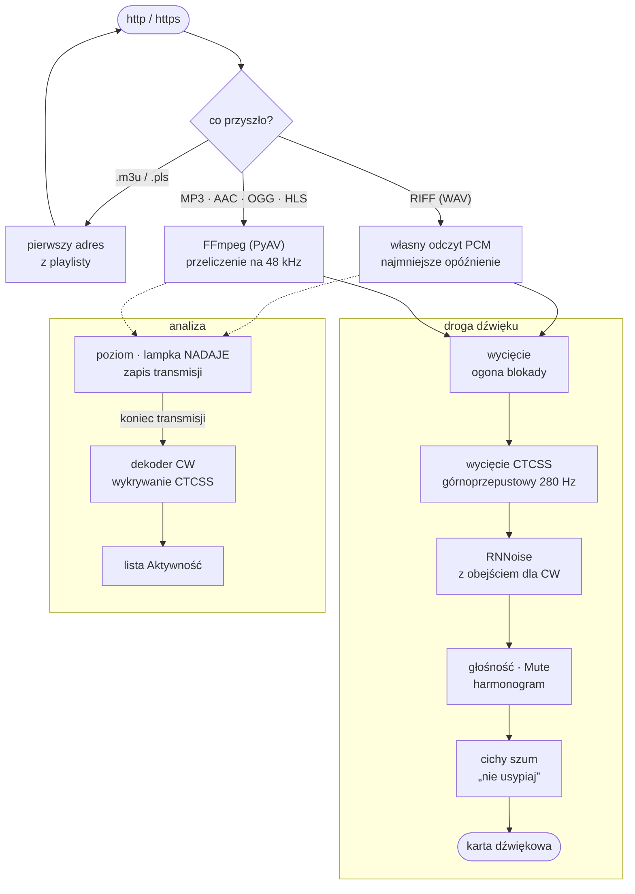

<p align="center"></p>

# Odsłuch stream

> 🇬🇧 English version: [README.md](README.md)

**Mały program dla Windows do słuchania strumieni audio przez internet: nasłuchów przemienników (WAV) i radia
internetowego (MP3, AAC, OGG, HLS). Każdy strumień ma własne okno, a okna mogą grać jednocześnie. W trakcie słuchania
program wpisuje na listę każdą transmisję z godziną i czasem trwania, odczytuje identyfikatory nadawane telegrafią,
pokazuje ton CTCSS (i potrafi go wyciąć), wycina ogon blokady szumów i odszumia dźwięk przez RNNoise.**

<p align="center">
  
</p>
<p align="center"><sub>Symulowany strumień przemiennika z lokalnego serwera testowego. Program odczytał z dźwięku
identyfikatory telegrafią <i>DE SP9TKN</i> i <i>VVV TEST</i>, oznaczył transmisje głosowe (<i>fonia</i>) i wykrył
ton CTCSS 67,0 Hz.</sub></p>

## Możliwości

- **Strumienie http i https:** WAV przez własny odczyt PCM (najmniejsze opóźnienie); MP3, AAC, OGG (Opus, Vorbis,
  FLAC) i HLS (`.m3u8`) przez FFmpeg; playlisty `.m3u` i `.pls`. Tytuły z radia internetowego (ICY) widać w linii
  stanu, a na liście aktywności na niebiesko z ♪.
- **Kilka strumieni naraz:** przycisk *Lista strumieni ▾* rozwija listę zapisanych strumieni. Kliknięcie otwiera
  strumień w nowym oknie, prawy przycisk pozwala go edytować albo usunąć. Każde okno ma własne ustawienia.
- **Lista Aktywność:** każda transmisja z początkiem, końcem i czasem trwania, a dalej *CW: …*, gdy program odczytał
  telegrafię (np. identyfikator przemiennika), albo *fonia*, oraz ton CTCSS.
- **CTCSS:** wykrywanie podnośnej (50 standardowych tonów). *wyłącz ton* wycina ją z dźwięku, a *wytnij ogon*
  wycisza szum blokady na końcu każdej transmisji.
- **Odszumianie RNNoise** działa na komputerze, bez internetu, z regulacją siły. Przy telegrafii i tonach samo się
  wyłącza, żeby ich nie wyciąć.
- **Harmonogram:** dźwięk tylko w ustawionych godzinach, także przez północ. Poza nimi dźwięk jest wyciszony, a odbiór
  i lista aktywności działają dalej.
- Głośność 0–200 % (kółko myszy: wolno ±1 %, szybko ±10 %), Mute, miernik poziomu w dBFS i lampka *NADAJE*.
- **Głośnik nie usypia:** bardzo cichy szum dla głośników, które same się wyłączają w ciszy (np. JBL).
- **Nadąża za zmianami dźwięku Windows:** gdy zmieni się domyślne wyjście (np. po włączeniu Pulpitu zdalnego) albo
  urządzenie zniknie, dźwięk sam się przełącza bez przerywania odbioru.
- Dymek z opisem przy każdym elemencie: najedź myszą i kliknij **prawym** przyciskiem.

## Więcej okien

<p align="center">
  
  
</p>
<p align="center">
  
</p>
<p align="center"><sub>Radio internetowe z tytułem utworu · lista strumieni (● = okno otwarte) · dymek po kliknięciu
prawym przyciskiem. Wszystkie zrzuty pochodzą z działającego programu, uruchomionego na osobnym, pustym folderze
ustawień.</sub></p>

## Jak to działa



- **Transmisja** zaczyna się, gdy poziom przekroczy −55 dBFS, i kończy po 2 s ciszy. Każda jest nagrywana,
  a po zakończeniu analizowana.
- **Dekoder CW** szuka tonu między 400 a 1500 Hz, rozdziela kropki i kreski przez grupowanie, sprawdza rytm
  i czystość kluczowania, żeby muzyka i mowa nie dawały fałszywej telegrafii. Na trzech stacjach z muzyką nie zgłosił
  CW w żadnym z 661 badanych okien, a odczytał wszystkie 8 nagranych beaconów przemiennika i 20 z 20 sztucznych
  sygnałów CW w silnym szumie.
- **CTCSS:** widmo 60–260 Hz jest porównywane z 50 standardowymi tonami (±1 Hz). Ton wycina górnoprzepustowy filtr
  FIR (okno Kaisera) od 280 Hz, więc głos od 300 Hz zostaje bez zmian.
- **RNNoise** (Xiph.Org) jest nauczony na mowie i wyciąłby telegrafię. Gdy ten sam ton powtarza się, a detektor mowy
  RNNoise mówi „to nie mowa”, program przepuszcza oryginalny dźwięk.
- Dźwięk dochodzi z opóźnieniem ok. 1 s (bufor, wycinanie ogona i odszumianie).
- Ustawienia: `%APPDATA%\Odsluch_stream\config.json`. Dziennik: `%APPDATA%\Odsluch_stream\dziennik.log` (start
  i koniec, ponowne połączenia, błędy; klucze w adresach strumieni są zamazywane).

## Pobieranie

W **[Releases](../../releases)** jest `Odsluch_stream.exe` (Windows 10/11, 64-bit, ok. 65 MB, bez instalacji)
z licencjami i krótką instrukcją po polsku i angielsku. Program nie ma podpisu cyfrowego, więc Windows może pokazać
*System Windows ochronił ten komputer*: kliknij *Więcej informacji* i *Uruchom mimo to*. Niektóre antywirusy
ostrzegają przed programami spakowanymi PyInstallerem.

## Budowanie

- **Ze źródeł:** Python 3.14 (64-bit), `pip install -r requirements.txt`, potem `py odsluch.py`.
- **Exe:** `build.cmd` (PyInstaller, jeden plik, bez konsoli) → `dist\Odsluch_stream.exe`.
- **Własny strumień domyślny:** utwórz `domyslne.py` obok `odsluch.py`:
  ```python
  DOMYSLNY_URL = "https://example.org/stream.wav"
  DOMYSLNA_NAZWA = "Mój przemiennik"
  ```
  Wypełnia pierwszy strumień, gdy ustawienia są puste. Git pomija ten plik, a `build.cmd` nie dołącza go do exe
  (`--exclude-module domyslne`); do własnego exe usuń tę opcję.
- **Ikonę** (czajnik) rysuje `narzedzia/ikona_czajnik.py` (wymaga Pillow).

## Licencja

[GPL-3.0](LICENSE) © 2026 SP9TKN.

Dołączony cudzy kod: [RNNoise](https://gitlab.xiph.org/xiph/rnnoise) (Xiph.Org, Mozilla, Jean-Marc Valin;
BSD-3-Clause) jako biblioteka DLL z pakietu [pyrnnoise](https://pypi.org/project/pyrnnoise/) (Apache-2.0), zobacz
`rnnoise/`. [FFmpeg](https://ffmpeg.org) (LGPL-3.0 lub nowsza, bez części GPL i non-free) przez
[PyAV](https://github.com/PyAV-Org/PyAV) (BSD-3-Clause), zobacz `licencje_av/` z adresami źródeł. Do tego numpy
(BSD-3-Clause), sounddevice i PortAudio (MIT), Python i Tcl/Tk.

**Narzędzia:** program powstał z pomocą [Claude Code](https://claude.com/claude-code) (Anthropic) — asystent AI
do pisania kodu, testów i dokumentacji.
